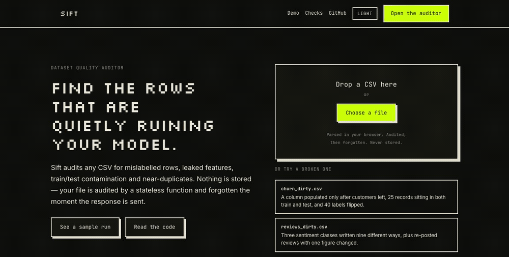

# Sift

Sift cleans a messy CSV without the notebook. Drop a file in and it runs twenty-nine checks, fixes the unambiguous problems in one click, and hands you the rest with the row numbers and a reason.

Live: <https://sift-csv.vercel.app/> · Sample datasets load from the empty state, so you can try it without uploading anything.



## Why

Every new dataset meant the same half hour. Count the nulls, find the duplicates, discover the category column has four spellings of the same value, write the same six lines I wrote last month, lose the notebook, write them again for the next file. None of it is difficult, and the faults worth catching hide behind the boring ones. So the tool splits fixes that need a decision from fixes that do not: duplicates, spelling variants, constant columns and half-empty rows go on one button, while the leaked column, the contaminated rows and the model's opinion about your labels are shown with their evidence and left alone until you say so.

## What it checks

Duplicate rows, train/test overlap, missing values, constant and ID-like columns, mixed types, outliers, categories spelled four ways, words standing in for a missing value, `-999` meaning "no reading", columns computed from other columns, and labels the model disagrees with. Twenty-six of the twenty-nine run without a label column; the other three say so rather than quietly returning less.

## How the interesting three work

Most of the checks are rules. These three are not, and they are the reason the project exists.

**Mislabelled rows.** Every row is scored by a 5-fold cross-validated model that never saw it, and that model's accuracy is printed next to the flags: if it only scored 0.55, every flag it produced is noise.

**Leaked features.** A depth-3 tree is fitted on each column on its own and compared against the majority-class baseline. A column that beats that baseline badly is not a strong feature — it is the answer copied into the input, usually populated after the outcome was known. Cheapest check in the tool, and it has caught the most interesting things.

**Train/test contamination.** Rows on both sides of a split, exactly and approximately. The validation score comes back high and nothing in the training curve warns you.

## Watching it argue against itself

Audit the churn sample, drop the leaked column it just found along with the contaminated rows, re-audit:

```
before  ·  cv accuracy 0.985  ·  39 rows flagged
after   ·  cv accuracy 0.710  ·  108 rows flagged
```

Accuracy falls and the flags nearly triple, because without the leak the model is genuinely uncertain. The first line is the one you would have believed if the tool had hidden its own accuracy. The five numbers behind the flags were swept against datasets with faults injected on purpose: [the thresholds I chose and why](docs/thresholds.md).

## What it can't do

Files up to 50,000 rows, because the audit holds the whole frame in memory. Classification labels only; I have not written the regression version. CSV and TSV only. Nothing is saved, so reload the page and your work is gone. That is deliberate.

## Running it locally

```
git clone https://github.com/vibey19/sift
cd sift
python3.12 -m venv .venv && source .venv/bin/activate
pip install -r requirements-dev.txt
npm install
```

Then `uvicorn api.index:app --reload --port 8000` and `npm run dev` in two terminals. Tests are `pytest -q` and `npm test`. Pin the virtualenv to Python 3.12, or wheels resolve differently between development and deployment.

## Stack

Two endpoints, `POST /api/profile` and `POST /api/audit`. pandas and scikit-learn do everything analytical: no deep learning, no API calls, no model downloads, because sentence-transformers pulls in PyTorch and would not deploy on a free tier. React with plain JSX and nothing beyond it. Every edit happens client-side, so the server is stateless by construction rather than by discipline.
